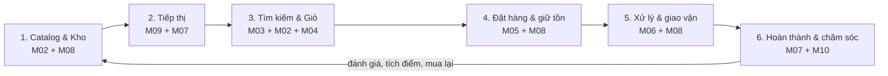
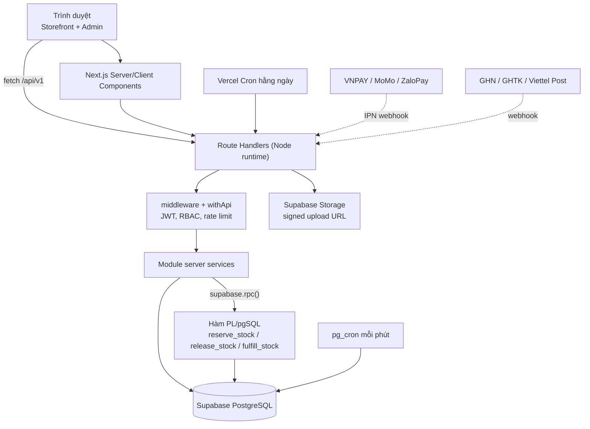

# KAIDO E-commerce

Nền tảng website bán đồ chơi trẻ em **KAIDO** — storefront cho phụ huynh và back-office cho vận hành viên. Repo này là **khung nền tảng** (foundation) của 10 phân hệ TOY-M01…TOY-M10: schema dữ liệu, hợp đồng API, hạ tầng xác thực/phân quyền, layout và design system. Nghiệp vụ chi tiết được triển khai ở các giai đoạn sau.

> Trạng thái hiện tại: **Skeleton** — mọi endpoint nghiệp vụ trả `501 NOT_IMPLEMENTED` đúng envelope; health, cron và các trang khung đã chạy được.

## 1. Giới thiệu và mục tiêu

- Xây dựng một ứng dụng **Next.js full-stack** duy nhất (App Router), backend là Route Handlers, dữ liệu trên **Supabase PostgreSQL**, triển khai trên **Vercel**.
- Phục vụ hai nhóm người dùng: khách mua đồ chơi (storefront) và nhân sự cửa hàng (kho, bán hàng, marketing, CSKH, quản trị).
- Mục tiêu kỹ thuật: một nguồn sự thật cho hằng số nghiệp vụ và endpoint, ranh giới server/client rõ ràng, thao tác tồn kho nguyên tử, bảo mật JWT tự quản, UI tiếng Việt có thể mở rộng theo SRS.
- Mục tiêu của lần khởi tạo: chốt **hợp đồng** (schema, API, quy ước, cấu trúc module) để nhiều người có thể nhận module và làm song song mà không phá vỡ kiến trúc.

## 2. Phạm vi và 10 phân hệ

SRS chia hệ thống thành 10 phân hệ, tất cả đều **High (Must-have)**. Số FR ghi theo bảng chức năng thực tế trong SRS (xem ghi chú đếm lại tại [docs/OPEN_DECISIONS.md](docs/OPEN_DECISIONS.md#8-số-liệu-srs)).

| Mã      | Phân hệ                         | Phạm vi cốt lõi                                                               | Ưu tiên          | FR  |
| ------- | ------------------------------- | ----------------------------------------------------------------------------- | ---------------- | --- |
| TOY-M01 | Tài khoản và người dùng         | Đăng ký, đăng nhập JWT, hồ sơ, sổ địa chỉ, quên mật khẩu, quản trị người dùng | High (Must-have) | 7   |
| TOY-M02 | Sản phẩm và danh mục            | Cây danh mục đa cấp, thương hiệu, thuộc tính đồ chơi, SKU, giá, biến thể, ảnh | High (Must-have) | 13  |
| TOY-M03 | Tìm kiếm, lọc, sắp xếp          | Tìm không dấu, autocomplete, faceted search, sắp xếp, phân trang              | High (Must-have) | 12  |
| TOY-M04 | Giỏ hàng                        | Mini-cart, giỏ khách/thành viên, gộp giỏ, kiểm tra tồn, áp coupon             | High (Must-have) | 10  |
| TOY-M05 | Đặt hàng và thanh toán          | Checkout, VNPAY/MoMo/ZaloPay/COD, giữ tồn ACID, vòng đời đơn, hủy đơn         | High (Must-have) | 11  |
| TOY-M06 | Đơn hàng và giao vận            | Điều phối đơn, vận đơn, webhook ĐVVC, đổi trả hàng                            | High (Must-have) | 14  |
| TOY-M07 | Khuyến mãi và khách thân thiết  | Tích/tiêu điểm, 4 hạng thành viên, voucher, sinh nhật                         | High (Must-have) | 7   |
| TOY-M08 | Kho và tồn kho                  | On-hand / Reserved / Available, nhập kho, kiểm kê, thẻ kho, cảnh báo tồn thấp | High (Must-have) | 13  |
| TOY-M09 | Nội dung và chiến dịch quảng bá | Banner, bài viết, campaign/Flash Sale, coupon dùng chung                      | High (Must-have) | 8   |
| TOY-M10 | Hỗ trợ khách hàng và đánh giá   | Verified review, kiểm duyệt, ticket CSKH, FAQ                                 | High (Must-have) | 11  |

Tổng thực tế: **106 FR**, **53 BR**, **65 API**, **38 NFR** (31 NFR module + 7 NFR hệ thống). Trang bìa SRS ghi 93 FR / 81 BR / 92 API / 53 NFR; chênh lệch được ghi nhận thay vì sửa tài liệu nguồn.

**Ngoài phạm vi lần khởi tạo:** nghiệp vụ chi tiết, tích hợp thật với cổng thanh toán/ĐVVC/email, giao diện pixel-perfect, worker thường trực, thư viện native.

## 3. Luồng nghiệp vụ khép kín (SRS §2.1)

1. **Nhập liệu Catalog & Kho:** Admin tạo danh mục, sản phẩm (M02). Thủ kho lập phiếu nhập (M08) làm tăng `on_hand`.
2. **Tiếp thị & Quảng bá:** Marketing cấu hình banner, bài viết (M09) và voucher (M07).
3. **Tìm kiếm & Giỏ hàng:** Khách tìm kiếm (M03), xem sản phẩm (M02), thêm vào giỏ (M04). Tồn khả dụng `Available = On-hand − Reserved`.
4. **Đặt hàng & Khóa kho:** Khách đặt hàng (M05); hệ thống giữ tồn (M08), áp voucher (M07/M09), tạo đơn.
5. **Xử lý & Giao vận:** Nhân viên xác nhận, đóng gói, tạo vận đơn (M06); xuất kho thực tế (M08); ĐVVC cập nhật qua webhook.
6. **Hoàn thành & Chăm sóc:** Đơn giao thành công cộng điểm (M07); khách đánh giá và mở ticket hỗ trợ (M10).



## 4. Ma trận RBAC

Nguồn: SRS §2.2 và `src/shared/rbac/permissions.js`. Role `MARKETING` được bổ sung theo OPEN_DECISIONS #4; `STAFF` đảm nhiệm đồng thời NV Bán hàng và CSKH.

| Module               | Khách vãng lai    | Khách hàng           | Nhân viên kho     | STAFF (bán hàng/CSKH)      | MARKETING          | ADMIN              |
| -------------------- | ----------------- | -------------------- | ----------------- | -------------------------- | ------------------ | ------------------ |
| M01 Tài khoản        | Đăng ký/đăng nhập | Toàn quyền cá nhân   | Xem thông tin đơn | Xem thông tin đơn          | —                  | Quản lý toàn bộ    |
| M02 Sản phẩm         | Xem               | Xem                  | Xem tồn kho       | Xem sản phẩm               | Xem sản phẩm       | Quản trị catalog   |
| M03 Tìm kiếm         | Tra cứu           | Tra cứu              | —                 | Tra cứu nội bộ             | Xem từ khóa hot    | Phân tích search   |
| M04 Giỏ hàng         | Giỏ tạm           | Giỏ cá nhân          | —                 | Hỗ trợ khách               | —                  | Xem thống kê       |
| M05 Đặt hàng         | Xem chính sách    | Tạo đơn/thanh toán   | —                 | Tạo đơn hỗ trợ             | —                  | Quản lý doanh thu  |
| M06 Đơn & vận chuyển | Tra cứu theo mã   | Xem/hủy đơn của mình | In phiếu đóng gói | Duyệt/xử lý đơn, CSKH      | —                  | Cấu hình ĐVVC      |
| M07 Khuyến mãi       | Xem ưu đãi        | Tích/tiêu điểm       | —                 | Áp mã hộ khách             | Tạo voucher        | Cấu hình loyalty   |
| M08 Kho              | —                 | —                    | Nhập/xuất/kiểm kê | Xem tồn khả dụng           | —                  | Duyệt lệch kiểm kê |
| M09 Nội dung         | Xem               | Xem                  | —                 | —                          | Soạn bài/up banner | Duyệt hiển thị     |
| M10 Review & hỗ trợ  | Xem               | Gửi review/ticket    | —                 | Trả lời ticket, kiểm duyệt | Phân tích phản hồi | Quản lý FAQ/ticket |

## 5. Kiến trúc và công nghệ

- **Một app Next.js 16.4.2** (App Router, React 19.3.1, JavaScript + JSDoc): UI và API cùng repo, deploy Vercel region `sin1`.
- **Supabase**: PostgreSQL 15+ cho dữ liệu, Storage cho ảnh/tệp. Trình duyệt **không** gọi Supabase trực tiếp; server dùng service role key.
- **Xác thực tự quản**: JWT HS256 qua `jose` (access 15 phút, giữ trong bộ nhớ), refresh token 7 ngày trong cookie HttpOnly; mật khẩu `bcryptjs`.
- **Giao diện**: Tailwind CSS 3.4.19 với design tokens KAIDO, Baloo 2/Nunito, TanStack Query 5, Zustand 5, React Hook Form 7 + Zod 3.
- **Chất lượng**: Vitest 5, ESLint 9 (flat config + rule ranh giới module), Prettier 3, GitHub Actions CI.



## 6. Cấu trúc thư mục

```text
.
├── database/              # schema.sql, seed.sql, migrations/, README
├── docs/                  # tài liệu dự án + docs/source (SRS, Blueprint — không sửa)
├── eslint-rules/          # rule ranh giới client/server và module
├── scripts/               # gen-routes.js, check-modules.js
├── src/
│   ├── app/               # App Router: (storefront), (account), (admin), (checkout), api
│   ├── middleware.js      # chặn thô route cần đăng nhập
│   ├── modules/           # m01-account … m10-support
│   │   └── mXX-*/         # public.server.js, public.client.js, server/, client/
│   ├── server/            # db, auth, http (withApi), security, cache, integrations
│   ├── shared/            # constants, rbac, lib, hooks, ui, layouts, auth, utils
│   └── styles/            # tokens.css
├── test/                  # test setup dùng chung
├── next.config.js
├── tailwind.config.js
└── vercel.json
```

> Next.js yêu cầu middleware cùng cấp thư mục `app`; vì app nằm trong `src/`, middleware đặt tại `src/middleware.js` thay vì root (OPEN_DECISIONS #23).

## 7. Bắt đầu nhanh

**Yêu cầu:** Node.js ≥ 20.9 (xem `.nvmrc`), npm 11, một project Supabase.

```bash
npm install
cp .env.example .env.local   # điền Supabase URL + service role key + JWT secrets
npm run gen:routes           # sinh route từ registry (idempotent)
npm run dev                  # http://localhost:3000
```

Một lần cho mỗi môi trường Supabase:

1. Tạo project **region Singapore** (gần Vercel `sin1`).
2. SQL Editor: chạy `database/schema.sql`, sau đó `database/seed.sql`.
3. Bật extension `pgcrypto`, `unaccent`, `pg_trgm`, `pg_cron`; chạy lại khối `pg_cron` cuối `schema.sql`.
4. Storage: tạo bucket `kaido-media` (public hoặc private + signed URL).
5. Điền biến môi trường theo [docs/DEPLOYMENT.md](docs/DEPLOYMENT.md). **Không** commit `.env.local`, không dùng tiền tố `NEXT_PUBLIC_` cho khóa bí mật.

Kiểm tra nhanh: `GET /api/v1/health` → `200` với envelope `{ success: true, data: ... }`. `npm run build` chạy được **không cần** bí mật thật vì route khung không kết nối DB lúc build.

Các lệnh chất lượng:

```bash
npm run lint
npm run test
npm run check:modules
npm run build
```

## 8. Cách nhận một module

1. Cập nhật `main`, tạo nhánh: `git checkout -b feature/m05-checkout`.
2. Đọc `src/modules/mXX-*/README.md` — FR, BR, validation, API, UI components và chế độ render.
3. Liệt kê việc cần làm: `grep -rn "TODO(M05" src/modules/m05-checkout src/app`.
4. Đọc hợp đồng với module khác trong `public.server.js` / `public.client.js`; không import sâu.
5. Triển khai **server trước** (validation → service → handler), sau đó client (service → hook → component).
6. Thêm/sửa test Vitest; chạy `npm run lint && npm run test && npm run check:modules && npm run build`.
7. Cập nhật `README.md` của module và `docs/OPEN_DECISIONS.md` nếu phát sinh quyết định mới.
8. Mở PR theo `.github/PULL_REQUEST_TEMPLATE.md`; mỗi PR chỉ nên tập trung một module.

**Thứ tự làm đề xuất theo phụ thuộc:** M01 → M02 → M08 → M03 → M09 → M04 → M05 → M06 → M07 → M10. Xem chi tiết ở [docs/MODULES.md](docs/MODULES.md).

## 9. Quy ước code, API, branch, commit

### Code

- JavaScript ES Modules + JSDoc; **không** dùng TypeScript. UI và thông báo lỗi bằng tiếng Việt, giữ nguyên mã SRS (`M05-F02`, `BR-M05-01`, `API-M05-02`…).
- `src/server/**` và `src/modules/*/server/**` bắt đầu bằng `import 'server-only'`.
- Client/shared **không** import `src/server/**`; browser **không** gọi Supabase; access token **chỉ** trong bộ nhớ, không `localStorage`.
- Module chỉ được import module khác qua `public.server.js` / `public.client.js` (ESLint `kaido/no-deep-cross-module-imports`).
- Không rải số nghiệp vụ trong code: dùng `src/shared/constants/business-rules.js`, đồng bộ với `system_settings`.
- M03 chỉ đọc dữ liệu M02; M02 không phụ thuộc ngược M03. Một `CouponService` duy nhất (M09) cho M04/M05/M07.

### API

- Tiền tố `/api/v1`. Registry là nguồn sự thật: `src/shared/api-endpoints.js` (65 endpoint).
- Thành công: `{ "success": true, "data": ..., "meta": { "requestId": ..., ... } }`.
- Lỗi: `{ "success": false, "error": { "code", "message", "details"? }, "requestId" }`.
- Route mỏng được sinh bởi `npm run gen:routes`; không sửa tay route đã sinh, sửa registry rồi chạy lại.
- Tham số động thống nhất: `[orderRef]`, `[idOrSlug]`, `[ticketRef]`, `[itemId]`, `[id]`.
- Endpoint admin: chưa đăng nhập → `401`, sai role → `403`. Cron đọc `CRON_SECRET`.
- Thao tác nguyên tử phải là hàm PL/pgSQL gọi bằng `supabase.rpc()`.

### Branch & commit

- Nhánh: `feature/mXX-ten-ngan`, `fix/mXX-ten-loi`, `chore/...`, `docs/...`.
- Commit Conventional Commits, scope là module: `feat(m05): giữ tồn kho khi đặt hàng`, `fix(m01): chặn đăng nhập sai 5 lần`, `docs(m08): cập nhật API catalog`.
- Không commit bí mật, file build, hoặc thay đổi trong `docs/source/`.

## 10. NFR cấp hệ thống (SRS)

| Mã         | Nhóm                | Tiêu chí             | Mục tiêu                                                     |
| ---------- | ------------------- | -------------------- | ------------------------------------------------------------ |
| SYS-NFR-01 | Hiệu năng           | FCP trang khách hàng | < 1,5 giây trên 4G tiêu chuẩn                                |
| SYS-NFR-02 | Khả năng mở rộng    | Đồng thời            | ≥ 1.000 CCU và 100 giao dịch/giây                            |
| SYS-NFR-03 | Khả dụng            | Uptime               | ≥ 99,9% (tối đa ~8,7 giờ gián đoạn/năm)                      |
| SYS-NFR-04 | Bảo mật             | Mã hóa & thanh toán  | HTTPS/TLS 1.3, bcrypt salt ≥ 10, PCI-DSS qua cổng thanh toán |
| SYS-NFR-05 | Sao lưu & khôi phục | RPO / RTO            | Sao lưu 6 giờ/lần; RPO < 6 giờ, RTO < 30 phút                |
| SYS-NFR-06 | Tương thích         | Thiết bị/trình duyệt | Chrome, Safari, Edge, Firefox; Mobile/Tablet/Desktop         |
| SYS-NFR-07 | Kiểm toán           | Thay đổi nhạy cảm    | Giá, tồn kho, trạng thái đơn ghi log bất biến                |

Ngoài ra SRS có **31 NFR cấp module** (M01–M10). Tổng thực tế 38 NFR.

## 11. Trạng thái từng module

Tất cả module ở trạng thái **Skeleton**: server có validation/service/handler trả 501, client có service/hook/component khung, metadata kèm mã SRS/TODO. README của module ghi rõ FR, BR, API, UI và chế độ render.

| Module | Server skeleton | Client skeleton | README | FR  | API | Trạng thái |
| ------ | --------------- | --------------- | ------ | --- | --- | ---------- |
| M01    | Có              | Có              | Có     | 7   | 7   | Skeleton   |
| M02    | Có              | Có              | Có     | 13  | 7   | Skeleton   |
| M03    | Có              | Có              | Có     | 12  | 4   | Skeleton   |
| M04    | Có              | Có              | Có     | 10  | 7   | Skeleton   |
| M05    | Có              | Có              | Có     | 11  | 7   | Skeleton   |
| M06    | Có              | Có              | Có     | 14  | 7   | Skeleton   |
| M07    | Có              | Có              | Có     | 7   | 6   | Skeleton   |
| M08    | Có              | Có              | Có     | 13  | 7   | Skeleton   |
| M09    | Có              | Có              | Có     | 8   | 6   | Skeleton   |
| M10    | Có              | Có              | Có     | 11  | 7   | Skeleton   |

Đã hoàn thành ở tầng nền: 55 bảng + seed, 3 hàm tồn kho nguyên tử, JWT/RBAC/rate limit, 61 route API (60 nghiệp vụ + health), 42 route trang, design system, header tích hợp AuthModal/SearchBar/CartBadge/MiniCartDrawer/MegaMenuCategory, CI.

## 12. Liên kết tài liệu

- [docs/MODULES.md](docs/MODULES.md) — owner, phụ thuộc, số FR/API, trạng thái.
- [docs/ARCHITECTURE.md](docs/ARCHITECTURE.md) — ranh giới, luồng tồn kho, vòng đời đơn, job nền.
- [docs/API_CATALOG.md](docs/API_CATALOG.md) — toàn bộ 65 endpoint.
- [docs/DATABASE.md](docs/DATABASE.md) — ERD, RPC, migration, RLS.
- [docs/DEPLOYMENT.md](docs/DEPLOYMENT.md) — Supabase, Vercel, biến môi trường, cron, webhook.
- [docs/CONTRIBUTING.md](docs/CONTRIBUTING.md) — quy trình đóng góp.
- [docs/DESIGN_SYSTEM.md](docs/DESIGN_SYSTEM.md) — token, component, a11y, SEO.
- [docs/OPEN_DECISIONS.md](docs/OPEN_DECISIONS.md) — mâu thuẫn/thiếu sót và mặc định đang áp dụng.
- [database/README.md](database/README.md) — hướng dẫn schema, seed, pg_cron, Storage.
- `docs/source/` — SRS và Blueprint gốc (không sửa).
