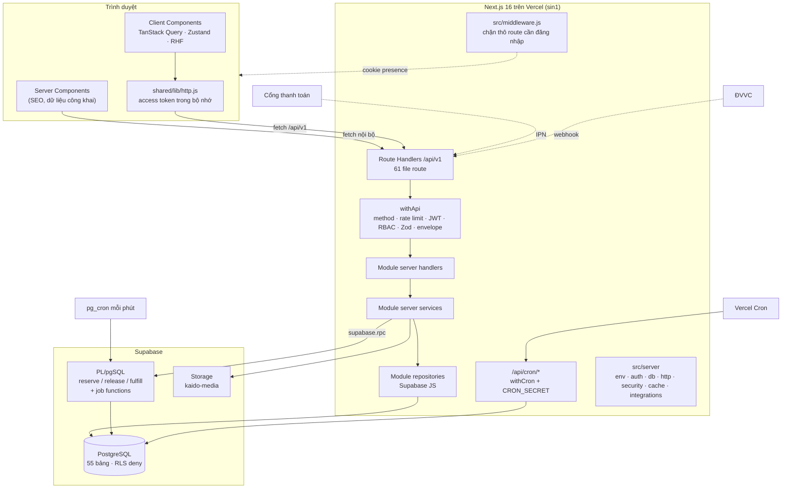
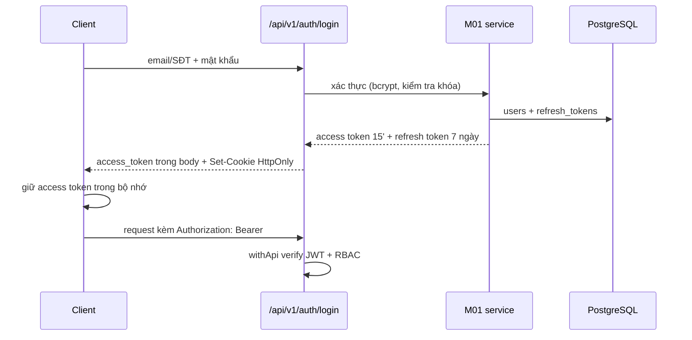
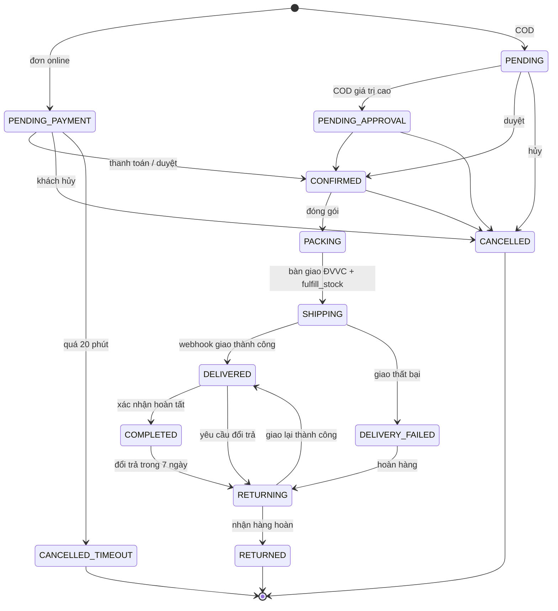

# Architecture — KAIDO E-commerce

Tài liệu này mô tả kiến trúc nền tảng đã dựng: ranh giới server/client, quy tắc phụ thuộc module, luồng tồn kho, vòng đời đơn và job nền. Nghiệp vụ chi tiết được cài đặt ở giai đoạn module.

## 1. Nguyên tắc kiến trúc

1. **Một ứng dụng Next.js full-stack** (App Router): UI và API cùng repo, cùng pipeline build, deploy Vercel region `sin1`.
2. **Serverless, không có tiến trình thường trực.** Không dùng `node-cron` hay worker; việc định kỳ chạy bằng `pg_cron` (mỗi phút) hoặc Vercel Cron (hằng ngày).
3. **Trình duyệt không gọi Supabase trực tiếp.** Mọi truy cập dữ liệu đi qua Route Handler; service role key chỉ tồn tại phía server.
4. **Registry là nguồn sự thật của API.** 65 endpoint khai báo trong `src/shared/api-endpoints.js`; route, hook, service client và tài liệu đều dẫn xuất từ đây.
5. **Hằng số nghiệp vụ tập trung.** `src/shared/constants/business-rules.js` đồng bộ với `system_settings`; không rải "số ma thuật" trong code.
6. **SQL chịu trách nhiệm nguyên tử.** Thao tác đa bảng/khóa dòng nằm trong hàm PL/pgSQL gọi bằng `supabase.rpc()`, không ghép nhiều câu lệnh rời.
7. **Ranh giới module rõ ràng.** Import chéo chỉ qua `public.server.js` / `public.client.js`; client không chạm server code.

## 2. Sơ đồ thành phần



## 3. Ranh giới server/client

### 3.1. Cấu trúc một module

```text
src/modules/mXX-ten/
├── README.md               # FR, BR, validation, API, UI, chế độ render
├── public.server.js        # hợp đồng server-only cho module khác
├── public.client.js        # component/hook công khai cho module khác
├── server/
│   ├── constants.js        # mã FR/BR/API, enum, hằng số module
│   ├── validation.js       # Zod schema theo endpoint
│   ├── repository.js       # truy vấn Supabase, không chứa nghiệp vụ
│   ├── service.js          # nghiệp vụ, gọi RPC, gọi public.server module khác
│   └── handlers.js         # handler nhận ctx từ withApi
└── client/
    ├── pages/              # page khung theo route thuộc module
    ├── components/         # component theo bảng UI Components của SRS
    ├── hooks/              # hook TanStack Query, một hook/API
    └── services/           # hàm gọi API, path đọc từ registry
```

### 3.2. Quy tắc bắt buộc

| Quy tắc                                                                          | Công cụ thực thi                                   |
| -------------------------------------------------------------------------------- | -------------------------------------------------- |
| `src/server/**` và `src/modules/*/server/**` bắt đầu bằng `import 'server-only'` | Review + test/CI                                   |
| Client/shared không import `src/server/**` hay `server/**` của module            | ESLint `kaido/no-client-server-imports`            |
| Module chỉ import module khác qua `public.server.js` / `public.client.js`        | ESLint `kaido/no-deep-cross-module-imports`        |
| Browser không dùng Supabase SDK, không giữ access token trong `localStorage`     | Review; `http.js` chỉ dùng biến module             |
| Không có bí mật trong biến `NEXT_PUBLIC_*`                                       | `.env.example`, review, checklist deploy           |
| Route sinh tự động không sửa tay                                                 | `scripts/gen-routes.js`, CI `git diff --exit-code` |

`src/shared/**` chỉ chứa code an toàn cho cả hai phía: constants, RBAC, UI thuần, utils, validation dùng chung, auth store phía client. Logic cần DB/secret phải nằm trong `src/server/**`.

### 3.3. Luồng một request API

```text
Request
  → src/middleware.js (chỉ với /account, /admin, /checkout: kiểm tra cookie)
  → route.js (mỏng, sinh tự động)
  → withApi(code, handler, { schemas })
      1. tra registry theo code
      2. so method (405 nếu sai)
      3. rate limit theo endpoint.rateLimit (auth/search/voucher)
      4. đọc Bearer token, verify JWT nếu endpoint yêu cầu
      5. RBAC: admin path + endpoint.roles (401/403)
      6. đọc body ≤ 1MB, query, params động
      7. Zod validate params/query/body (422)
      8. gọi handler(ctx)
  → service → repository → Supabase / RPC
  → successResponse / errorResponse
```

`ctx` truyền cho handler gồm: `request`, `params`, `query`, `body`, `rawBody`, `auth` (`userId`, `role`, `email`), `requestId`, `guestSessionId`, `endpoint`.

Envelope:

```json
{ "success": true, "data": {}, "meta": { "requestId": "..." } }
```

```json
{
  "success": false,
  "error": { "code": "VALIDATION_ERROR", "message": "...", "details": {} },
  "requestId": "..."
}
```

- `requestId` lấy từ header `X-Request-Id` nếu hợp lệ, ngược lại sinh UUID; trả lại trong `meta` (thành công), top-level (lỗi) và header.
- Lỗi nghiệp vụ dùng `AppError` với mã trong `src/shared/constants/error-codes.js`.
- Route khung hiện trả `501 NOT_IMPLEMENTED` kèm `details.todo` (mã FR/API). Đây là hành vi có chủ đích của foundation.

### 3.4. Xác thực và phân quyền



- **Access token** 15 phút, chỉ trong bộ nhớ (`src/shared/lib/http.js`); không `localStorage`.
- **Refresh token** 7 ngày trong cookie HttpOnly `kaido_refresh_token`; middleware chỉ kiểm tra cookie tồn tại để chuyển hướng thô, không xác thực chữ ký.
- Phân quyền thật nằm ở `withApi`. Admin path yêu cầu role thuộc nhóm vận hành (`canAccessAdminPanel`); endpoint `access: 'role'` kiểm tra thêm danh sách `roles`. Thiếu đăng nhập → `401`; sai quyền → `403`.
- Client có `ProtectedRoute` / `RoleRoute` để ẩn/hiển thị UI, nhưng đây chỉ là trải nghiệm; API vẫn là nơi quyết định.
- Endpoint refresh `POST /api/v1/auth/refresh` chưa có trong registry/SRS — xem [OPEN_DECISIONS #20](OPEN_DECISIONS.md#20-endpoint-refresh-token).

### 3.5. API registry và sinh route

- `src/shared/api-endpoints.js`: 65 bản ghi, mỗi bản ghi có `code`, `module`, `method`, `path`, `access`, `roles`, `operation`, `input`, `output`, `status`, có thể có `rateLimit`, `internal`, `aliasOf`.
- `scripts/gen-routes.js` sinh route mỏng cho 64 endpoint chính. Bốn cặp trùng path+method dùng chung một file:
  - `GET/PUT /user/profile`
  - `PUT/DELETE /admin/products/[id]`
  - `PUT/DELETE /cart/items/[itemId]`
  - `GET/POST /products/[idOrSlug]/reviews`
- `API-M06-05` là alias của `API-M05-05`; không sinh route riêng.
- `GET /api/v1/health` viết tay, không qua registry, trả 200 kể cả khi Supabase chưa cấu hình (`checks.database = "not_configured"`).

## 4. Quy tắc phụ thuộc module

Xem bảng và đồ thị tại [MODULES.md](MODULES.md#3-quy-tắc-phụ-thuộc). Tóm tắt:

- M03 chỉ đọc M02, không ghi catalog.
- M09 cung cấp **một** `CouponService`; M04/M05/M07 không tự tính coupon.
- M08 độc quyền thay đổi tồn kho qua 3 RPC.
- M01 cung cấp danh tính; M05 cung cấp đơn; M06 cung cấp vận chuyển.
- Các cạnh M05 ↔ M06, M05 ↔ M07, M04 ↔ M09 được giải quyết bằng `public.server.js` và thứ tự triển khai theo lớp.

## 5. Luồng tồn kho

### 5.1. Công thức

```text
Available = On-hand − Reserved
```

- `on_hand >= 0`, `reserved >= 0`, `reserved <= on_hand` (ràng buộc DB).
- `available` là cột generated trong `inventory_stocks`.
- Không service nào được `UPDATE inventory_stocks` trực tiếp; mọi thay đổi qua RPC.

### 5.2. Ba thao tác nguyên tử

| RPC                                            | Khi nào                         | Tác động                                                                                                              |
| ---------------------------------------------- | ------------------------------- | --------------------------------------------------------------------------------------------------------------------- |
| `reserve_stock(order_ref, items, expires_at?)` | Tạo đơn online/COD cần giữ hàng | Kiểm tra đủ tồn, tăng `reserved`, ghi `stock_reservations` (ACTIVE) và thẻ kho `RESERVE`; idempotent theo `order_ref` |
| `fulfill_stock(order_ref)`                     | Tạo vận đơn, xuất kho thật      | Giảm `on_hand` và `reserved`, đánh dấu reservation `FULFILLED`, ghi `FULFILL`                                         |
| `release_stock(order_ref)`                     | Hủy đơn, timeout, giao thất bại | Giảm `reserved`, đánh dấu `RELEASED`/`EXPIRED`, ghi `RELEASE`                                                         |

Reservation mặc định hết hạn sau **20 phút** (`payment_expires_at` của đơn online). `pg_cron` chạy mỗi phút để nhả reservation quá hạn và hủy đơn `PENDING_PAYMENT` quá hạn.

```mermaid
sequenceDiagram
  participant C as Khách
  participant O as M05 Order service
  participant I as M08 Inventory RPC
  participant DB as PostgreSQL
  C->>O: POST /api/v1/orders
  O->>I: rpc reserve_stock(order_ref, items)
  I->>DB: SELECT ... FOR UPDATE + kiểm tra available
  alt đủ tồn
    DB-->>I: reserved += qty, reservation ACTIVE
    I-->>O: reservation_id, expires_at (+20 phút)
    O-->>C: đơn PENDING_PAYMENT / PENDING
  else thiếu tồn
    DB-->>I: INSUFFICIENT_STOCK
    I-->>O: lỗi
    O-->>C: 409 INSUFFICIENT_STOCK
  end
  Note over DB: Quá 20 phút → pg_cron hủy đơn + release_stock
  Note over DB: Tạo vận đơn → fulfill_stock; hủy → release_stock
```

Chi tiết hàm, tham số và mã lỗi: [DATABASE.md](DATABASE.md#4-hàm-nguyên-tử-plpgsql).

## 6. Vòng đời đơn hàng

Enum thống nhất M05 + M06 trong `src/shared/constants/order-status.js`. Chuyển trạng thái hợp lệ theo `ORDER_TRANSITIONS`; mọi thay đổi ghi `order_status_history` (bảng bất biến).



- Khách được hủy ở `PENDING_PAYMENT`, `PENDING`, `PENDING_APPROVAL`, `CONFIRMED` (xem `CUSTOMER_CANCELLABLE_STATUSES`).
- Hủy đơn phải giải phóng tồn kho; giao thất bại tối đa 3 lần (`BR-M06-03`).
- Lịch sử trạng thái không được UPDATE/DELETE (trigger bất biến, `NFR-M06-03`).
- Nguồn thay đổi: `CUSTOMER`, `STAFF`, `SYSTEM`, `CARRIER` — khớp enum `order_change_source` trong DB và hằng số JS (xem [OPEN_DECISIONS #24](OPEN_DECISIONS.md#24-nguồn-thay-đổi-trạng-thái-đơn)).

## 7. Job nền

### 7.1. `pg_cron` — mỗi phút

| Job                                  | Hàm                              | Mục đích                                                                 |
| ------------------------------------ | -------------------------------- | ------------------------------------------------------------------------ |
| `kaido-cancel-timeout-orders`        | `cancel_timeout_orders()`        | Hủy đơn `PENDING_PAYMENT` quá `payment_expires_at`, nhả tồn, ghi lịch sử |
| `kaido-release-expired-reservations` | `release_expired_reservations()` | Nhả reservation `ACTIVE` quá hạn                                         |

Chạy trực tiếp trong PostgreSQL, không phụ thuộc gói Vercel. Đăng ký ở cuối `database/schema.sql`; xem hướng dẫn bật `pg_cron` tại [database/README.md](../database/README.md).

### 7.2. Vercel Cron — hằng ngày

| Route                             | Lịch (UTC)  | Nhiệm vụ dự kiến                                       |
| --------------------------------- | ----------- | ------------------------------------------------------ |
| `/api/cron/campaigns`             | `0 0 * * *` | Bật/kết thúc chiến dịch M09 theo `starts_at`/`ends_at` |
| `/api/cron/expire-loyalty-points` | `0 1 * * *` | Trừ điểm hết hạn M07                                   |
| `/api/cron/close-support-tickets` | `0 2 * * *` | Đóng ticket `RESOLVED` quá 72 giờ M10                  |
| `/api/cron/low-stock-scan`        | `0 3 * * *` | Quét tồn thấp, tạo thông báo M08                       |

- Bảo vệ bằng `Authorization: Bearer <CRON_SECRET>` qua `withCron`; sai/thiếu → `401`.
- Hiện thân job trả `501` (TODO của module tương ứng).
- Vercel Cron gửi GET. Giới hạn tần suất/số job phụ thuộc gói; job mỗi phút **không** đặt trên Vercel mà dùng `pg_cron`. Xem [DEPLOYMENT.md](DEPLOYMENT.md#7-cron-và-giới-hạn-serverless).

## 8. Cache, rate limit và hiệu năng

- **Client cache:** TanStack Query. Query key lấy từ mã endpoint (`['API-M04-01', variables]`), nhờ đó các component cùng dữ liệu (CartBadge + MiniCartDrawer) chia sẻ cache và invalidate thống nhất.
- **Server cache:** interface tại `src/server/cache/index.js` (mặc định in-memory, có thể thay Upstash/KV). Không lưu dữ liệu người dùng nhạy cảm trong cache toàn cục.
- **Rate limit:** `checkRateLimit` theo endpoint (`auth`, `search`, `voucher`). Bộ đếm in-memory chỉ đúng trong một instance; production nhiều instance nên cấu hình Upstash (`UPSTASH_REDIS_REST_*`).
- **Response API:** `cache-control: no-store`; dữ liệu công khai có thể cache ở tầng CDN/route sau này nếu hợp đồng cho phép.
- **Ảnh:** Next Image cho host `**.supabase.co`; upload lớn đi qua signed URL, không qua Route Handler.
- **Mục tiêu:** FCP < 1,5 giây trên 4G (SYS-NFR-01); ưu tiên Server Components cho trang SEO, skeleton thay spinner toàn trang.

## 9. Lỗi, quan sát và kiểm toán

- Mọi response đi qua `apiResponse` với envelope và `requestId`; lỗi 5xx được log kèm `requestId` (trừ `NOT_IMPLEMENTED` có chủ đích).
- Mã lỗi chuẩn: `VALIDATION_ERROR` (422), `UNAUTHORIZED` (401), `FORBIDDEN` (403), `NOT_FOUND` (404), `CONFLICT` (409), `RATE_LIMITED` (429), `NOT_IMPLEMENTED` (501), `SERVICE_UNAVAILABLE` (503)…
- Lỗi PostgREST/PostgreSQL được chuẩn hóa, không trả chi tiết nội bộ cho client.
- **Bảng bất biến:** `audit_logs`, `order_status_history`, `stock_movement_logs`. Thay đổi giá, tồn kho, trạng thái đơn phải ghi log (SYS-NFR-07).
- `/api/v1/health` báo trạng thái app/env/auth/cron/database, dùng cho smoke test sau deploy.

## 10. Bảo mật

| Chủ đề     | Cách làm                                                                                                         |
| ---------- | ---------------------------------------------------------------------------------------------------------------- |
| Bí mật     | Chỉ biến server; `.env.example` không có giá trị thật; không `NEXT_PUBLIC_` cho service role/JWT/cổng thanh toán |
| Dữ liệu    | Supabase service role chỉ ở server; RLS bật + không policy → từ chối mặc định                                    |
| Mật khẩu   | `bcryptjs`, cost ≥ 10 (mặc định 12), không lưu plaintext                                                         |
| JWT        | HS256, access 15 phút, refresh cookie HttpOnly; secret riêng cho từng loại token                                 |
| Webhook    | VNPAY HMAC-SHA512, ĐVVC HMAC, so sánh timing-safe; idempotency key cho giao dịch                                 |
| Upload     | Signed URL; giới hạn loại/kích thước tệp ở trigger và module                                                     |
| Input      | Zod ở biên API, sanitize nội dung người dùng, giới hạn body 1MB                                                  |
| Thanh toán | Không thu thập số thẻ; PCI-DSS do cổng thanh toán đảm nhiệm                                                      |

## 11. Kiểm thử và CI

- Vitest cho core server/shared: auth, withApi, rate limit, response envelope, cron.
- `npm run gen:routes` idempotent; CI kiểm tra không có diff sau khi sinh.
- CI chạy: install → gen routes → diff check → lint → test → check:modules → build.
- Test module mới nên bám mã FR/BR và validation trong README module; các luồng quan trọng cần test: khóa đăng nhập, tồn kho đồng thời, timeout 20 phút, chuyển trạng thái đơn, coupon.
