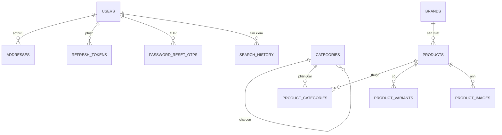
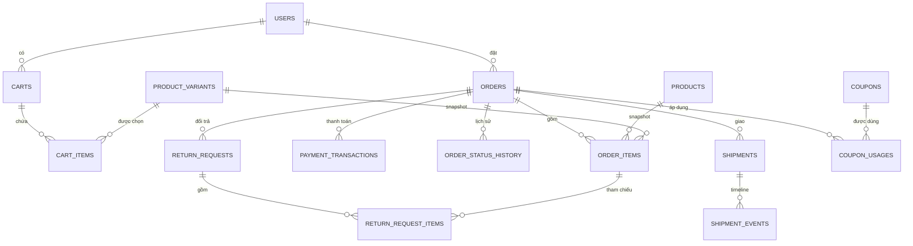
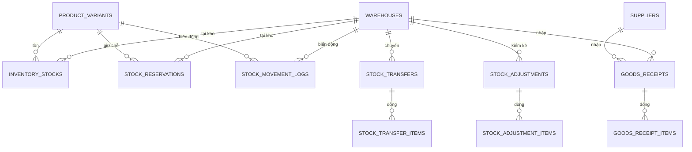
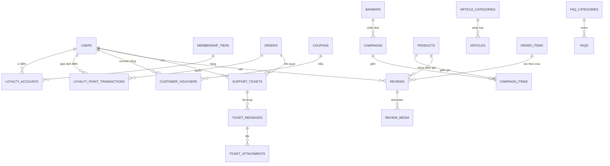

# Database — KAIDO E-commerce

Cơ sở dữ liệu là **PostgreSQL 15+ trên Supabase**. [`database/schema.sql`](../database/schema.sql) là baseline cho project mới; [`database/seed.sql`](../database/seed.sql) chứa dữ liệu tham chiếu/demo. Hướng dẫn cài đặt, reset và Storage nằm ở [`database/README.md`](../database/README.md).

- **55 bảng**, chia theo block TOY-M01…TOY-M10 + hệ thống.
- Khóa chính UUID (trừ bảng log dùng `bigserial`).
- RLS bật trên mọi bảng, **không tạo policy** → từ chối mặc định; backend dùng service role.
- Ba thao tác tồn kho nguyên tử bằng PL/pgSQL; hai job `pg_cron` mỗi phút.

## 1. Phân nhóm bảng

| Nhóm            | Bảng                                                                                                                                                                                                                          | Số bảng |
| --------------- | ----------------------------------------------------------------------------------------------------------------------------------------------------------------------------------------------------------------------------- | ------: |
| Hệ thống        | `system_settings`, `audit_logs`, `notifications`                                                                                                                                                                              |       3 |
| M01 — Tài khoản | `users`, `addresses`, `refresh_tokens`, `password_reset_otps`                                                                                                                                                                 |       4 |
| M02 — Catalog   | `categories`, `brands`, `products`, `product_categories`, `product_variants`, `product_images`                                                                                                                                |       6 |
| M03 — Tìm kiếm  | `search_history`                                                                                                                                                                                                              |       1 |
| M04 — Giỏ hàng  | `carts`, `cart_items`, `cart_saved_items`                                                                                                                                                                                     |       3 |
| M05 — Đặt hàng  | `orders`, `order_items`, `payment_transactions`, `order_status_history`                                                                                                                                                       |       4 |
| M06 — Giao vận  | `shipments`, `shipment_events`, `shipping_fee_rules`, `return_requests`, `return_request_items`                                                                                                                               |       5 |
| M07 — Loyalty   | `coupons`, `coupon_usages`, `membership_tiers`, `loyalty_accounts`, `loyalty_point_transactions`, `customer_vouchers`                                                                                                         |       6 |
| M08 — Kho       | `warehouses`, `suppliers`, `inventory_stocks`, `stock_reservations`, `goods_receipts`, `goods_receipt_items`, `stock_adjustments`, `stock_adjustment_items`, `stock_transfers`, `stock_transfer_items`, `stock_movement_logs` |      11 |
| M09 — Nội dung  | `banners`, `article_categories`, `articles`, `campaigns`, `campaign_items`                                                                                                                                                    |       5 |
| M10 — Hỗ trợ    | `reviews`, `review_media`, `faq_categories`, `faqs`, `support_tickets`, `ticket_messages`, `ticket_attachments`                                                                                                               |       7 |
| **Tổng**        |                                                                                                                                                                                                                               |  **55** |

`coupons` nằm trong block M07 nhưng **M09 sở hữu CouponService** dùng chung cho M04/M05/M07 (xem [OPEN_DECISIONS #9](OPEN_DECISIONS.md#9-voucher-trùng-m07m09)).

## 2. ERD theo miền

ERD dưới đây lược bỏ các bảng log/cấu hình và một số cột; quan hệ đầy đủ nằm trong `schema.sql`.

### 2.1. Tài khoản và catalog



- `products` lưu `price_regular`, `price_sale` (0 ≤ sale ≤ regular), `age_group`, `gender_target`, `status`, `deleted_at`.
- Mỗi sản phẩm có ít nhất một variant; sản phẩm đơn dùng một variant mặc định (OPEN_DECISIONS #14). SKU duy nhất toàn hệ thống.

### 2.2. Giỏ hàng, đơn hàng, thanh toán, giao vận



- `orders.user_id` cho phép `NULL` để mở guest checkout sau này; hiện tại tạo đơn yêu cầu đăng nhập (OPEN_DECISIONS #5).
- `orders` snapshot người nhận và tổng tiền; `order_items` snapshot tên/SKU/giá tại thời điểm đặt (BR-M05-05).
- `orders` có `coupon_id`, `freeship_coupon_id`, `points_used`, `points_discount_amount`; ràng buộc tổng tiền:
  `total_amount = subtotal + shipping_fee − discount_amount − points_discount_amount`.
- `payment_transactions` có `idempotency_key` và unique `(provider, provider_transaction_id)` để chống trùng webhook.
- `shipments` giới hạn tối đa 3 lần giao thất bại; `shipment_events` là log webhook ĐVVC.
- `order_status_history` là bảng bất biến, lưu `from_status`, `to_status`, `change_source`, người đổi.

### 2.3. Tồn kho



- `inventory_stocks` có `on_hand`, `reserved`, cột generated `available = on_hand − reserved`; unique `(variant_id, warehouse_id)`.
- `stock_reservations.order_ref` là **text**, không FK sang `orders`, để M08 không phụ thuộc schema M05 và RPC nhận được mã đơn trước khi bản ghi đơn hoàn tất. Liên kết logic qua `order_code`.
- Unique index `(order_ref, variant_id, warehouse_id)` cho reservation `ACTIVE` bảo đảm idempotency.
- `stock_movement_logs` là thẻ kho bất biến; `quantity` có dấu theo loại biến động.
- Trigger/unique index đảm bảo một kho mặc định duy nhất.

### 2.4. Loyalty, nội dung, đánh giá, hỗ trợ



- `reviews.order_item_id` là **unique** → mỗi dòng hàng chỉ review một lần (Verified Purchase); review yêu cầu đơn `COMPLETED`.
- Trigger `sync_product_rating` cập nhật `products.rating_avg/rating_count` khi review đổi trạng thái/rating.
- `support_tickets.ticket_code` sinh `#TK-XXXXX`; ticket `RESOLVED` quá 72 giờ sẽ được cron đóng (M10).
- Giới hạn media (5 ảnh hoặc 1 video, ≤ 5MB/tệp) được trigger và module kiểm tra.

## 3. Enum và trạng thái

Enum khớp `src/shared/constants`:

- `role_type`: `CUSTOMER`, `STAFF`, `WAREHOUSE_KEEPER`, `MARKETING`, `ADMIN`.
- `order_status`: `PENDING_PAYMENT`, `PENDING`, `PENDING_APPROVAL`, `CONFIRMED`, `PACKING`, `SHIPPING`, `DELIVERED`, `COMPLETED`, `CANCELLED`, `CANCELLED_TIMEOUT`, `DELIVERY_FAILED`, `RETURNING`, `RETURNED`.
- `payment_method`: `COD`, `VNPAY`, `MOMO`, `ZALOPAY`; `payment_status`: `PENDING`, `SUCCESS`, `FAILED`, `REFUNDED`, `CANCELLED`.
- `shipment_status`: `PENDING`, `PICKED_UP`, `IN_TRANSIT`, `OUT_FOR_DELIVERY`, `DELIVERED`, `FAILED`, `RETURNING`, `RETURNED`.
- `reservation_status`: `ACTIVE`, `RELEASED`, `FULFILLED`, `EXPIRED`.
- `movement_type`: `IMPORT`, `EXPORT`, `RESERVE`, `RELEASE`, `FULFILL`, `ADJUST`, `TRANSFER_IN`, `TRANSFER_OUT`, `RETURN`.
- `membership_tier`: `BRONZE`, `SILVER`, `GOLD`, `DIAMOND`.
- `review_status`: `PENDING`, `APPROVED`, `REJECTED`, `HIDDEN`; `ticket_status`: `OPEN`, `IN_PROGRESS`, `RESOLVED`, `CLOSED`.
- Các enum còn lại: `account_status`, `product_status`, `age_group`, `gender_target`, `discount_type`, `coupon_scope`, `content_status`, `campaign_status`, `return_status`, `notification_*`…

Trạng thái đơn dùng **một enum thống nhất** M05 + M06 (OPEN_DECISIONS #6); bảng chuyển trạng thái hợp lệ ở `src/shared/constants/order-status.js`.

## 4. Hàm nguyên tử PL/pgSQL

Supabase JS đi qua PostgREST, không hỗ trợ transaction nhiều câu lệnh. Mọi thao tác cần ACID **phải** là hàm SQL gọi bằng `supabase.rpc()`.

| Hàm                                                  | Tham số                                                                                          | Trả về                                                    | Mục đích                                                                                                                                                                                        |
| ---------------------------------------------------- | ------------------------------------------------------------------------------------------------ | --------------------------------------------------------- | ----------------------------------------------------------------------------------------------------------------------------------------------------------------------------------------------- |
| `reserve_stock(p_order_ref, p_items, p_expires_at?)` | `p_items` JSONB `[{"variant_id","warehouse_id?","quantity"}]`; mặc định kho default, hạn 20 phút | JSONB `{order_ref, already_reserved, items, expires_at?}` | Khóa advisory theo `order_ref`, khóa dòng `inventory_stocks`, kiểm tra available, tăng `reserved`, tạo reservation ACTIVE + thẻ kho `RESERVE`. Idempotent: gọi lại trả `already_reserved: true` |
| `release_stock(p_order_ref)`                         | mã đơn                                                                                           | JSONB `{order_ref, released_items}`                       | Nhả reservation ACTIVE, giảm `reserved`, ghi `RELEASE`. Không lỗi nếu không còn reservation                                                                                                     |
| `fulfill_stock(p_order_ref)`                         | mã đơn                                                                                           | JSONB `{order_ref, fulfilled_items}`                      | Giảm cả `on_hand` và `reserved`, reservation `FULFILLED`, ghi `FULFILL`                                                                                                                         |
| `release_expired_reservations()`                     | —                                                                                                | integer                                                   | Nhả reservation ACTIVE quá hạn; chạy mỗi phút bởi `pg_cron`                                                                                                                                     |
| `cancel_timeout_orders()`                            | —                                                                                                | integer                                                   | Hủy đơn `PENDING_PAYMENT` quá `payment_expires_at`, gọi `release_stock`, ghi lịch sử; chạy mỗi phút                                                                                             |

Quy tắc:

1. **Không** `UPDATE inventory_stocks` trực tiếp trong service. Chỉ gọi 3 RPC reserve/release/fulfill.
2. RPC dùng `SECURITY INVOKER`; service role gọi từ server; không cấp quyền gọi cho `anon`/`authenticated`.
3. Thao tác nguyên tử mới phải viết thành hàm PL/pgSQL trước khi dùng:
   - Trừ/cộng điểm và tính hạng M07 (atomic trên `loyalty_accounts` + `loyalty_point_transactions`).
   - Tăng `coupons.used_count` + ghi `coupon_usages` M07/M09 (chống vượt lượt).
   - Hoàn tiền/đổi trả M06 nếu cần cập nhật nhiều bảng.
   - Nhập/kiểm kê/chuyển kho M08 nếu chưa gói trong RPC.
4. Lỗi nghiệp vụ dùng `RAISE EXCEPTION ... USING ERRCODE = 'P0001'`; `withApi` chuyển thành `AppError` (hiện map về `CONFLICT`). Khi triển khai module nên map mã lỗi cụ thể (`INSUFFICIENT_STOCK`…) ở service.

Ví dụ gọi (chỉ server):

```js
const { data, error } = await supabase.rpc('reserve_stock', {
  p_order_ref: orderCode,
  p_items: items.map((item) => ({ variant_id: item.variantId, quantity: item.quantity })),
});
```

## 5. Trigger và ràng buộc đáng chú ý

| Trigger / ràng buộc                  | Tác dụng                                                    |
| ------------------------------------ | ----------------------------------------------------------- |
| `trg_<table>_updated_at`             | Tự cập nhật `updated_at` cho các bảng có cột này            |
| `trg_addresses_limits`               | Tối đa 10 địa chỉ/user, đúng 1 địa chỉ mặc định (BR-M01-04) |
| `trg_product_images_limits`          | Tối đa 10 ảnh/sản phẩm (M02-F07)                            |
| `trg_banners_limit`                  | Tối đa 5 banner `HOME_HERO` đang bật (BR-M09-04)            |
| `trg_review_media_limit`             | Tối đa 5 ảnh hoặc 1 video/review (BR-M10-05)                |
| `trg_ticket_attachment_limit`        | Tối đa 5 ảnh hoặc 1 video/tin nhắn ticket                   |
| `trg_reviews_sync_rating`            | Đồng bộ `rating_avg`, `rating_count` khi review thay đổi    |
| `trg_audit_logs_immutable`           | Chặn UPDATE/DELETE `audit_logs` (SYS-NFR-07)                |
| `trg_order_status_history_immutable` | Chặn UPDATE/DELETE lịch sử trạng thái (NFR-M06-03)          |
| `trg_stock_movement_logs_immutable`  | Chặn UPDATE/DELETE thẻ kho (NFR-M08-03)                     |

Các CHECK quan trọng:

- Email/SĐT duy nhất; SKU duy nhất toàn hệ thống.
- `price_regular > 0`, `0 <= price_sale <= price_regular`.
- `on_hand >= 0`, `reserved >= 0`, `reserved <= on_hand`.
- `order_items.quantity BETWEEN 1 AND 20`; `line_total = unit_price * quantity`.
- Tổng tiền đơn khớp công thức; tiền tệ bắt buộc `VND`.
- Review 1–5 sao, nội dung 10–1000 ký tự.
- Mã coupon `^[A-Z0-9]{4,20}$`; coupon `PERCENT` trong 1–100; `used_count <= usage_limit`.

## 6. RLS và bảo mật dữ liệu

- `ALTER TABLE ... ENABLE ROW LEVEL SECURITY` cho **tất cả 55 bảng**, không tạo policy → `anon`/`authenticated` bị từ chối.
- Backend dùng `SUPABASE_SERVICE_ROLE_KEY` (bỏ qua RLS) **chỉ trên server**; trình duyệt không có Supabase client.
- Nếu tương lai dùng Supabase Auth cho client, phải viết policy riêng; hiện tại mọi truy cập đi qua API Next.js.
- Service role key và JWT secret không được đặt tiền tố `NEXT_PUBLIC_`; xem [DEPLOYMENT.md](DEPLOYMENT.md#5-biến-môi-trường).

## 7. Seed và dữ liệu demo

`seed.sql` tạo:

| Nội dung                    | Ghi chú                                                        |
| --------------------------- | -------------------------------------------------------------- |
| `system_settings` — 36 khóa | Giá trị mặc định theo SRS §2.7, khớp `business-rules.js`       |
| `membership_tiers`          | Bronze/Silver/Gold/Diamond, hệ số điểm 1.0/1.2/1.5/2.0         |
| `shipping_fee_rules`        | Nội thành 25.000đ; tỉnh 35.000–50.000đ; miễn phí từ 500.000đ   |
| `warehouses`                | 1 kho mặc định, địa chỉ DEMO                                   |
| `faq_categories`            | 4 nhóm FAQ                                                     |
| `categories`                | 5 danh mục cấp 1 **DEMO** từ Blueprint §3.1, đánh dấu `[DEMO]` |

Seed **không** tạo tài khoản/mật khẩu/hash. Script tạo Admin đầu tiên là TODO của M01 (`scripts/create-admin.js`), đọc `ADMIN_EMAIL`/`ADMIN_PASSWORD` từ biến môi trường. Dữ liệu demo phải được thay trước go-live (OPEN_DECISIONS #29).

## 8. Tìm kiếm không dấu

- Extension `unaccent` + `pg_trgm`; wrapper `immutable_unaccent(text)` để dùng được trong expression index.
- M03 dùng wrapper này cho tìm kiếm không dấu và trigram; không sửa dữ liệu nguồn M02.
- Nếu extension nằm ở schema `extensions`, wrapper tự resolve schema của extension.

## 9. Migrations

- `schema.sql` là baseline cho project mới. **Sau khi có dữ liệu thật, không sửa trực tiếp** `schema.sql`.
- Tạo file trong `database/migrations/`:
  - `001_mo_ta_ngan.sql`, `002_...sql`, đánh số tăng dần.
  - Mỗi file chạy một lần, ghi mã SRS liên quan ở đầu file.
  - Chạy trên staging trước, sau đó production.
- Có thể chuyển sang Supabase CLI (`supabase db push`) khi cả đội thống nhất; hiện tại dùng SQL Editor.
- Với thay đổi phá vỡ tương thích: thêm cột nullable/default trước, backfill, sau đó mới siết ràng buộc.

## 10. Reset môi trường dev

Chỉ trên project dev, không trên production:

```sql
DROP SCHEMA public CASCADE;
CREATE SCHEMA public;
-- Chạy lại schema.sql, bật extension, chạy seed.sql
```

Lệnh này xóa toàn bộ object trong schema `public`; cân nhắc Supabase Branching hoặc project dev riêng.

## 11. Liên kết

- Cài đặt, pg_cron, Storage, quyền: [`database/README.md`](../database/README.md)
- Luồng tồn kho và vòng đời đơn: [ARCHITECTURE.md](ARCHITECTURE.md#5-luồng-tồn-kho)
- Triển khai Supabase/Vercel: [DEPLOYMENT.md](DEPLOYMENT.md)
- Quyết định về thời gian giữ tồn, đơn vị hành chính, điểm thưởng: [OPEN_DECISIONS.md](OPEN_DECISIONS.md)
