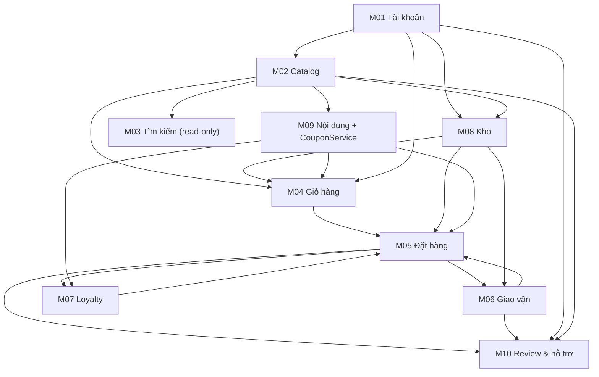

# Modules — KAIDO E-commerce

Mười phân hệ TOY-M01…TOY-M10, tất cả thuộc nhóm **High (Must-have)**. Mã SRS được giữ nguyên trong code, README module, route và test.

- Nguồn số liệu: bảng chức năng thực tế trong SRS (xem [OPEN_DECISIONS.md](OPEN_DECISIONS.md#8-số-liệu-srs)).
- Owner: **M06 và M08 — Tuann**; các module còn lại `(chưa phân công)`.
- Trạng thái chung: **Skeleton** — server trả `501` đúng envelope, client có service/hook/component khung.

## 1. Bảng module

| Mã      | Tên                             | Thư mục           | Owner            | Trạng thái | Phụ thuộc (nghiệp vụ)        | FR      | API    |
| ------- | ------------------------------- | ----------------- | ---------------- | ---------- | ---------------------------- | ------- | ------ |
| TOY-M01 | Tài khoản và người dùng         | `m01-account`     | (chưa phân công) | Skeleton   | —                            | 7       | 7      |
| TOY-M02 | Sản phẩm và danh mục            | `m02-catalog`     | (chưa phân công) | Skeleton   | M01                          | 13      | 7      |
| TOY-M03 | Tìm kiếm, lọc, sắp xếp          | `m03-search`      | (chưa phân công) | Skeleton   | M02 (chỉ đọc)                | 12      | 4      |
| TOY-M04 | Giỏ hàng                        | `m04-cart`        | (chưa phân công) | Skeleton   | M01, M02, M08, M09           | 10      | 7      |
| TOY-M05 | Đặt hàng và thanh toán          | `m05-checkout`    | (chưa phân công) | Skeleton   | M01, M04, M06, M07, M08, M09 | 11      | 7      |
| TOY-M06 | Đơn hàng và giao vận            | `m06-fulfillment` | **Tuann**        | Skeleton   | M01, M05, M08                | 14      | 7      |
| TOY-M07 | Khuyến mãi và khách thân thiết  | `m07-loyalty`     | (chưa phân công) | Skeleton   | M01, M05, M09                | 7       | 6      |
| TOY-M08 | Kho và tồn kho                  | `m08-inventory`   | **Tuann**        | Skeleton   | M01, M02                     | 13      | 7      |
| TOY-M09 | Nội dung và chiến dịch quảng bá | `m09-marketing`   | (chưa phân công) | Skeleton   | M01, M02                     | 8       | 6      |
| TOY-M10 | Hỗ trợ và đánh giá              | `m10-support`     | (chưa phân công) | Skeleton   | M01, M02, M05, M06           | 11      | 7      |
|         | **Tổng**                        |                   |                  |            |                              | **106** | **65** |

Ghi chú cột API: M06 có 7 endpoint, trong đó `API-M06-05` là alias của `API-M05-05` (trùng `POST /api/v1/orders/[orderRef]/cancel`), nên registry có **64 endpoint chính**. 60 file `route.js` nghiệp vụ + 1 file health = **61 file route**.

## 2. Phạm vi từng module

### TOY-M01 — Tài khoản và người dùng

Đăng ký, đăng nhập JWT tự quản, refresh token HttpOnly, hồ sơ, sổ địa chỉ (tối đa 10, đúng 1 mặc định), quên mật khẩu OTP, khóa đăng nhập sai, quản trị người dùng.
Thư mục: [`src/modules/m01-account`](../src/modules/m01-account/README.md).

### TOY-M02 — Sản phẩm và danh mục

Cây danh mục đa cấp, thương hiệu, thuộc tính đồ chơi (độ tuổi, giới tính), SKU, giá thường/giá sale, biến thể, ảnh, trạng thái publish, xóa mềm, delta catalog cho search index.
Thư mục: [`src/modules/m02-catalog`](../src/modules/m02-catalog/README.md).

### TOY-M03 — Tìm kiếm, lọc, sắp xếp

Tìm không dấu, autocomplete từ 2 ký tự, faceted search (danh mục, thương hiệu, giá, độ tuổi, giới tính, tồn kho, đang sale), sắp xếp, phân trang mặc định 12, từ khóa phổ biến và thống kê.
Thư mục: [`src/modules/m03-search`](../src/modules/m03-search/README.md). **Chỉ đọc** dữ liệu M02, không sở hữu bảng catalog.

### TOY-M04 — Giỏ hàng

Giỏ khách vãng lai theo `X-Guest-Session-Id`, giỏ thành viên, mini-cart, thêm/sửa/xóa/bulk delete, gộp giỏ khi đăng nhập, kiểm tra tồn khả dụng, tối đa 20 đơn vị/SKU, áp coupon qua `CouponService` của M09.
Thư mục: [`src/modules/m04-cart`](../src/modules/m04-cart/README.md).

### TOY-M05 — Đặt hàng và thanh toán

Checkout, tóm tắt đơn, tạo đơn, giữ tồn nguyên tử, COD/VNPAY/MoMo/ZaloPay (interface), IPN, hủy đơn, danh sách đơn và chuyển trạng thái cho admin. Đơn online quá 20 phút bị hủy tự động.
Thư mục: [`src/modules/m05-checkout`](../src/modules/m05-checkout/README.md).

### TOY-M06 — Đơn hàng và giao vận

Tính phí ship, tạo vận đơn, bàn giao ĐVVC, webhook vận chuyển, timeline tracking, hủy đơn (alias M05), yêu cầu đổi trả và duyệt đổi trả.
Thư mục: [`src/modules/m06-fulfillment`](../src/modules/m06-fulfillment/README.md).

### TOY-M07 — Khuyến mãi và khách thân thiết

Ví điểm, 4 hạng Bronze/Silver/Gold/Diamond, tích/tiêu điểm (bội số 10, tối đa 50% hóa đơn), lịch sử điểm, voucher, quà sinh nhật, thống kê hạng.
Thư mục: [`src/modules/m07-loyalty`](../src/modules/m07-loyalty/README.md).

### TOY-M08 — Kho và tồn kho

`On-hand / Reserved / Available`, giữ/nhả/xuất tồn bằng RPC, phiếu nhập, kiểm kê có duyệt, chuyển kho, thẻ kho bất biến, cảnh báo tồn thấp.
Thư mục: [`src/modules/m08-inventory`](../src/modules/m08-inventory/README.md).

### TOY-M09 — Nội dung và chiến dịch quảng bá

Banner theo vị trí, bài viết, chiến dịch/Flash Sale, coupon và **CouponService dùng chung** cho M04/F07, M05 và M07.
Thư mục: [`src/modules/m09-marketing`](../src/modules/m09-marketing/README.md).

### TOY-M10 — Hỗ trợ khách hàng và đánh giá

Verified review (chỉ khách đã mua, đơn `COMPLETED`), kiểm duyệt và đồng bộ rating, ticket CSKH `#TK-XXXXX`, FAQ, đính kèm ảnh/video.
Thư mục: [`src/modules/m10-support`](../src/modules/m10-support/README.md).

## 3. Quy tắc phụ thuộc

1. **M03 không sở hữu dữ liệu M02.** M03 chỉ đọc bảng catalog và delta sync; không ghi ngược vào M02.
2. **Một `CouponService` duy nhất tại M09.** M04, M05, M07 gọi qua `public.server.js` của M09; không tự tính coupon.
3. **Một enum trạng thái đơn** dùng chung M05 + M06 (`src/shared/constants/order-status.js`), lịch sử chuyển trạng thái là bảng bất biến.
4. **M08 sở hữu tồn kho.** Mọi thay đổi `inventory_stocks` đi qua `reserve_stock`, `release_stock`, `fulfill_stock`; module khác không UPDATE trực tiếp.
5. **M01 sở hữu danh tính.** Các module khác chỉ đọc thông tin người dùng qua `public.server.js` M01 hoặc JWT context, không join thẳng vào bảng `users` ngoài repository của mình khi có thể tránh.
6. Import chéo module chỉ qua `public.server.js` / `public.client.js`; ESLint `kaido/no-deep-cross-module-imports` chặn phần còn lại.
7. `src/server/**` và `src/modules/*/server/**` là server-only; client không được import.

### Đồ thị phụ thuộc (rút gọn)

Các cạnh hai chiều có chủ đích:

- **M05 ↔ M06:** M05 cần `API-M06-01` để tính phí ship; M06 cần đơn của M05 để tạo vận đơn. Khi làm M05 có thể dùng interface tính phí; hoàn thiện M06 ngay sau.
- **M05 ↔ M07:** M05 cần tính/tiêu điểm (`API-M07-04`); M07 cần đơn `COMPLETED` để tích điểm. Làm phần đọc/tiêu điểm của M07 trước, gắn tích điểm sau khi M05 chạy được.
- **M05 → M09:** coupon dùng chung; CouponService nên hoàn thiện trước khi làm M04-F07/M05.

## 4. Thứ tự triển khai đề xuất

Theo lớp phụ thuộc, không nhất thiết tuần tự tuyệt đối:

| Lớp | Module          | Lý do                                                            |
| --- | --------------- | ---------------------------------------------------------------- |
| 1   | M01, M02, M08   | Danh tính, catalog, tồn kho là nền của mọi luồng                 |
| 2   | M03, M09        | M03 đọc catalog; M09 cung cấp CouponService và nội dung          |
| 3   | M04, M07 (điểm) | Giỏ cần catalog/tồn/coupon; điểm cần ví và API tính giảm giá     |
| 4   | M05, M06        | Đặt hàng cần giỏ, tồn, coupon, phí ship; M06 hoàn thiện giao vận |
| 5   | M07 (tích điểm) | Tích điểm sau khi đơn `COMPLETED` chạy được                      |
| 6   | M10             | Review/ticket cần đơn hoàn thành và dữ liệu vận chuyển           |

Một thứ tự tuyến tính gợi ý: **M01 → M02 → M08 → M03 → M09 → M04 → M05 → M06 → M07 → M10**, với lưu ý ở trên về các cạnh hai chiều.

## 5. Cách nhận module và Definition of Done

1. Nhận owner trong bảng trên (cập nhật khi có phân công chính thức).
2. Đọc `src/modules/mXX-*/README.md` và danh sách TODO: `grep -rn "TODO(MXX" src/modules/mXX-* src/app`.
3. Làm server trước: validation → service → handler → gắn route đã sinh.
4. Làm client: service → hook → component/page.
5. Viết test; chạy `npm run lint && npm run test && npm run check:modules && npm run build`.
6. Cập nhật README module, API_CATALOG nếu hợp đồng đổi, và OPEN_DECISIONS nếu có quyết định mới.

Một module được coi là **Done** khi:

- Toàn bộ FR/BR/validation của module được triển khai, không còn TODO nghiệp vụ.
- API thật trả dữ liệu (không còn `501`), có validation và phân quyền đúng registry.
- UI thay thế `ModuleStub`, có trạng thái loading/empty/error.
- Có test cho luồng chính và các BR quan trọng.
- README module và tài liệu liên quan được cập nhật; CI xanh.

## 6. Kiểm tra cấu trúc

`npm run check:modules` xác nhận:

- Mỗi module có đủ `README.md`, `public.server.js`, `public.client.js`, 5 file `server/*`, 4 thư mục `client/*`.
- Mọi endpoint chính trong registry có file `route.js` tương ứng và mã API xuất hiện trong file.
- Không thiếu route do quên chạy `npm run gen:routes`.

Script thoát mã lỗi `1` nếu phát hiện thiếu, dùng được trong CI.
